* Table of Contents
{:toc}

## **Acknowledgements**

ClubLogistics builds on the [SE-EDU AddressBook Level 3](https://github.com/se-edu/addressbook-level3)
application framework. It uses JavaFX for the desktop interface, Jackson for JSON storage, JUnit 5 for tests,
and Gradle for builds.

## **Setting up, getting started**

Refer to [Setting up and getting started](SettingUp.md). Build and run the project with Java 25.

## **Design**

### Architecture

**Main components**

`Main` acquires an OS file lock on `.clublogistics.lock` in the application home before launching `MainApp`.
It holds the lock until the JavaFX application exits, preventing concurrent sessions from replacing the same
register with stale data. A second instance reports a startup error without loading equipment or preferences.
The lock file remains after shutdown; closing the channel, or process termination, releases the OS lock.

`MainApp` manages application startup and shutdown:

* On startup, it creates and connects the storage, model, logic, and UI components and loads preferences
  and equipment data. Missing equipment data uses sample data; invalid equipment data uses an empty register.
* On shutdown, it saves the user preferences, including window settings.

The four main components are:

* [**`UI`**](#ui-component): Displays equipment and handles user input.
* [**`Logic`**](#logic-component): Parses and executes commands.
* [**`Model`**](#model-component): Holds equipment data and user preferences in memory.
* [**`Storage`**](#storage-component): Reads and writes equipment data and preferences.

[**`Commons`**](#common-classes) contains utilities shared by multiple components.

**Component interactions**

The sequence diagram below shows the interactions for a successful `remove CAM001` command, assuming
`CAM001` is registered and available. Parsing, equipment lookup, and availability checks are omitted.

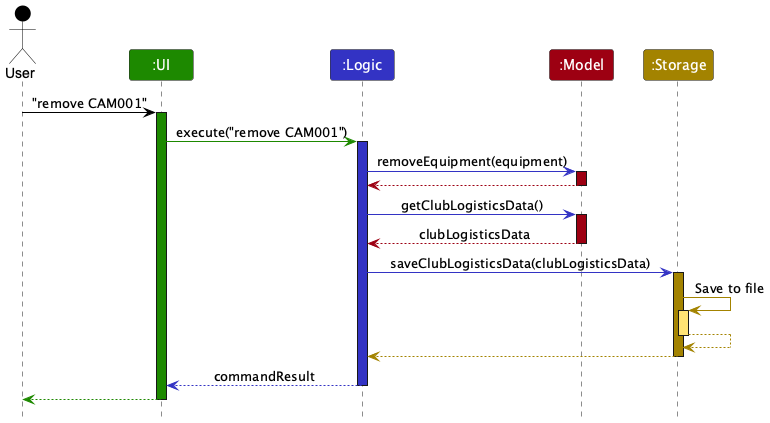

Each component exposes its API through an interface (`Ui`, `Logic`, `Model`, or `Storage`) and implements it
in a corresponding manager class (`UiManager`, `LogicManager`, `ModelManager`, or `StorageManager`).

For example, `Logic.java` declares the command API and `LogicManager.java` implements it. Components depend
on these interfaces rather than specific implementations. The partial class diagram below shows this
relationship for `LogicManager`, `Model`, and `Storage`.


### UI component

`UiManager` creates `MainWindow`. The window contains `CommandBox`, `ResultDisplay`, `EquipmentListPanel`,
and `StatusBarFooter`. `EquipmentListPanel` displays `EquipmentCard` instances bound to the model's filtered
observable equipment list. Cards show each item's ID, name, and availability or borrower. `HelpWindow`
displays the ClubLogistics User Guide link. Visible components inherit from `UiPart` and use matching FXML layouts.

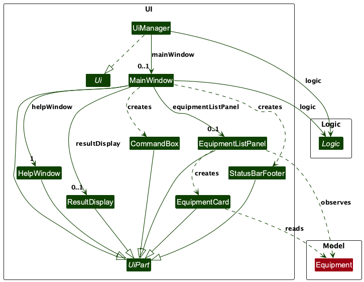

*Equipment UI classes and their relationships. Solid arrows represent stored references,
dashed arrows represent dependencies, and hollow triangles represent inheritance or interface realization.*

`UiManager` holds a `Logic` reference and creates `MainWindow` during `start`. Its window reference
is initially absent. Every successfully constructed `MainWindow` creates one `HelpWindow`, whether
or not that help window is visible. `fillInnerParts()` initializes the equipment panel and result
display, which are stored in fields; both are absent before that method runs.

`MainWindow` passes `logic.getFilteredEquipmentList()` to
`EquipmentListPanel(ObservableList<Equipment>)`. The panel observes the list and creates an
`EquipmentCard` for each non-empty cell. Cards read equipment data, including the borrower and status;
they do not mutate the model. `CommandBox` receives the window's command-execution callback.

The window attaches the root nodes of `CommandBox`, `ResultDisplay`, `EquipmentListPanel`, and
`StatusBarFooter` to its JavaFX placeholders. This scene-graph containment is distinct from Java
object fields: `CommandBox` and `StatusBarFooter` are local variables in `fillInnerParts()`, so the
diagram shows creation dependencies rather than stored associations for these two wrappers.
All seven UI part classes inherit from `UiPart`; `UiManager` implements `Ui`.

### Logic component

`LogicManager.execute` passes input to `ClubLogisticsParser`, executes the resulting command against `Model`,
and saves the register after successful execution, except for `help` and `exit`, which do not write equipment data.
Parse and command errors are reported to the user. If saving throws an `IOException`, Logic restores the
pre-command equipment register and reports a command error, with a separate message for permission failures.
This restores in-memory records; it does not guarantee that a failed file write left the file intact.

The supported commands are `add`, `remove`, `list`, `filter`, `issue`, `return`, `clear`, `help`, and `exit`.
Each equipment command parser validates its own positional arguments. For example, `issue CAM001 John Tan`
creates an `IssueCommand` containing an `EquipmentId` and a `BorrowerName`.

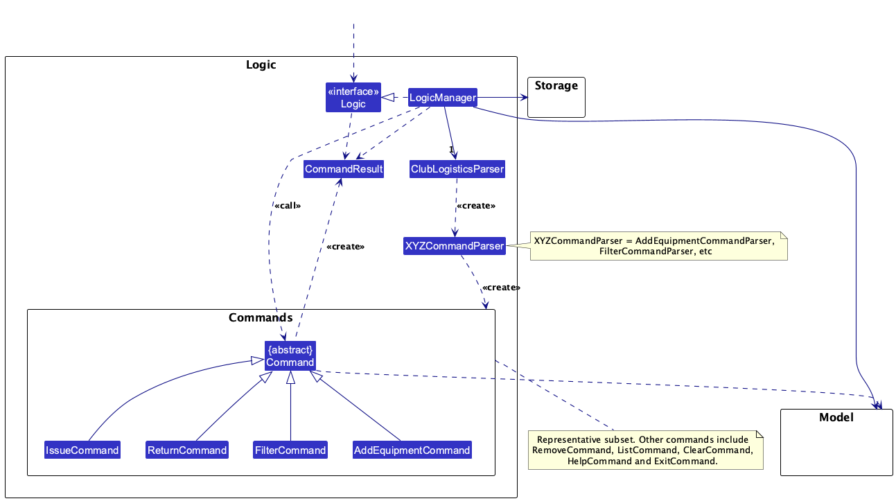

*Structure of the Logic component. `LogicManager` owns one `ClubLogisticsParser` (solid arrow), which creates command
parsers (`XYZCommandParser`, such as `FilterCommandParser`), which in turn create concrete `Command` objects
(dashed `<<create>>` arrows). `LogicManager` calls the resulting `Command`, which uses the `Model` and returns a
`CommandResult`. The commands shown are a representative subset.*

#### Positional command parsers

The following classes are used for parsing user commands:

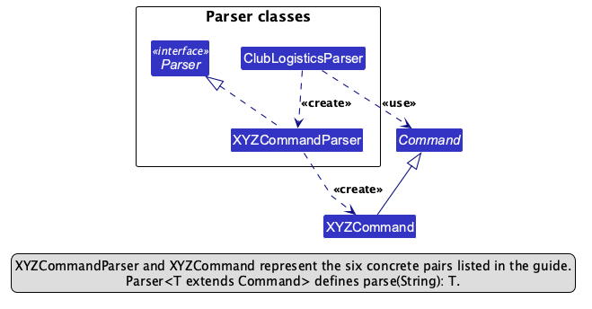

How the parsing works:

* `ClubLogisticsParser` creates the matching `XYZCommandParser`, which parses the arguments and creates an
  `XYZCommand`. The resulting command is returned to `LogicManager` for execution.
* All `XYZCommandParser` classes implement `Parser<T extends Command>`.

`XYZCommandParser` and `XYZCommand` are placeholders for the following concrete classes:

| Command word | `XYZCommandParser` represents | `XYZCommand` represents |
| --- | --- | --- |
| `add` | `AddEquipmentCommandParser` | `AddEquipmentCommand` |
| `remove` | `RemoveCommandParser` | `RemoveCommand` |
| `list` | `ListCommandParser` | `ListCommand` |
| `filter` | `FilterCommandParser` | `FilterCommand` |
| `issue` | `IssueCommandParser` | `IssueCommand` |
| `return` | `ReturnCommandParser` | `ReturnCommand` |
| `clear` | `ClearCommandParser` | `ClearCommand` |
| `help` | `HelpCommandParser` | `HelpCommand` |
| `exit` | `ExitCommandParser` | `ExitCommand` |

### Model component

`ModelManager` owns a copy of `ClubLogisticsData`, user preferences, and a `FilteredList<Equipment>`.
`ClubLogisticsData` uses `UniqueEquipmentList` to enforce case-insensitive ID uniqueness and exposes an
unmodifiable observable equipment list. Replacing the register validates all records before changing the live list.

`Equipment` is immutable. Its `EquipmentId`, `EquipmentName`, and optional `BorrowerName` describe one physical
item. Equipment is available when no borrower is recorded and issued otherwise. Issuing and returning replace
the item, so observers receive the updated record without losing the selected filter.

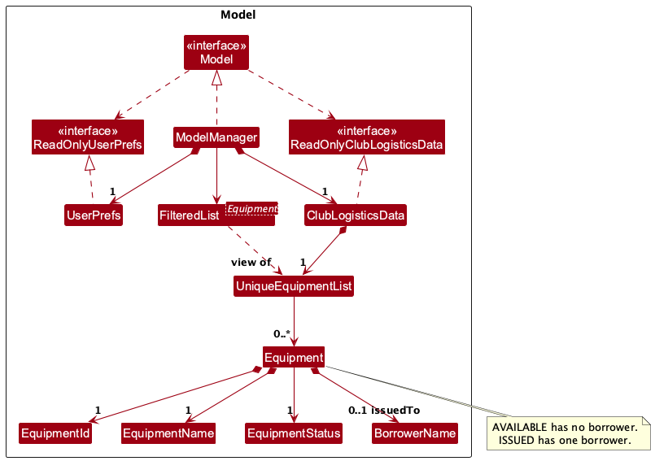

*Structure of the Model component. `ModelManager` owns the register (`ClubLogisticsData`) and a filtered view of its
equipment. `ClubLogisticsData` stores uniquely identified `Equipment` records. An `AVAILABLE` record has no borrower;
an `ISSUED` record has exactly one `BorrowerName`.*

### Storage component

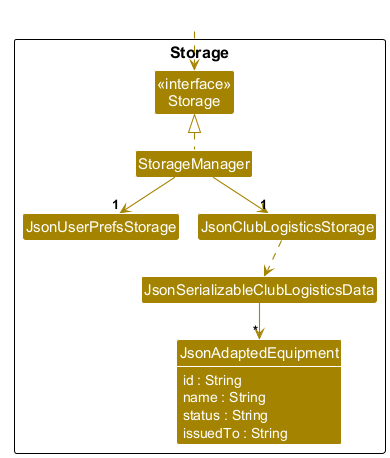

*Structure of the Storage component*

`StorageManager` delegates to `JsonUserPrefsStorage` and `JsonClubLogisticsStorage`. The latter reads and writes
`JsonSerializableClubLogisticsData`, whose top-level `equipment` array contains `JsonAdaptedEquipment` records.
Each record stores `id`, `name`, `status`, and `issuedTo`. `status` must be `AVAILABLE` with a null or empty
`issuedTo`, or `ISSUED` with a valid borrower; any other combination causes loading to fail. A record without
`status` is accepted for compatibility with older files, and its status is inferred from the borrower. Saving always
writes `status`. Invalid IDs, names, borrowers, statuses, duplicate IDs, and null records also cause loading to fail.
No contact register is stored.

The application uses `data/clublogistics.json` exclusively. No data migration is performed.

### Common classes

The `commons` package provides logging, file and JSON utilities, argument checks, and window settings.
`LogsCenter` writes `clublogistics.log` files and uses the `clublogistics` logger hierarchy.

## **Implementation**

### Shared command and observation pipeline

The walkthroughs below use positional commands dispatched by `ClubLogisticsParser`. Each parser constructs a
command or throws `ParseException`; commands report failed preconditions with `CommandException` before
mutating the register. Such failures do not reach the save step. Equipment lookup uses the full register,
so an item can be issued, returned, or removed even when the active filter hides it.

`ModelManager` retains one `ClubLogisticsData` and one `FilteredList<Equipment>` over its unmodifiable
observable list. Register methods delegate to `UniqueEquipmentList`, whose internal observable list is
changed with `add`, `remove`, `set`, or `setAll`. These changes propagate through the existing filtered view
to `EquipmentListPanel` and its `EquipmentCard` cells. Commands do not recreate the UI or replace its list
binding. The selected predicate remains active after record changes and register resets.

For successful data commands, `LogicManager` saves the complete register before returning `CommandResult`.
`MainWindow.executeCommand` sends its feedback to `ResultDisplay`; equipment cards come from the observable
list, rather than being parsed from that feedback. The feature diagrams focus on command collaborators;
the [architecture interaction diagram](#architecture) supplies the surrounding UI/Logic/save interaction.

### Registering equipment

For `add CAM001 Sony Camera`:

1. `ClubLogisticsParser` delegates the arguments to `AddEquipmentCommandParser`. The parser trims them
   and splits on whitespace at most once: `CAM001` is the ID and the remaining text is the equipment name.
2. `EquipmentId` accepts 1–20 ASCII letters or digits and preserves spelling for display. Equality and
   lookup ignore letter case. `EquipmentName` trims and collapses whitespace, then requires 1–50 characters
   made up of Unicode letters, digits, spaces and the symbols `- / ' . , & ( ) # + :`. Storage applies the same
   check when loading, so the saved file cannot hold a name the `add` command would reject. For example, `add CAM001 Sony   Camera` creates the name `Sony Camera`.
3. The parser creates an available `Equipment` with no borrower and passes it to `AddEquipmentCommand`.
   The command calls `model.hasEquipment`; an existing `cam001` therefore rejects `CAM001` as a duplicate.
4. On success, `ModelManager.addEquipment` delegates through `ClubLogisticsData.addEquipment` to
   `UniqueEquipmentList.add`. That list also enforces ID uniqueness. Observers update and Logic saves.
   Feedback is `Equipment CAM001 added successfully.`.

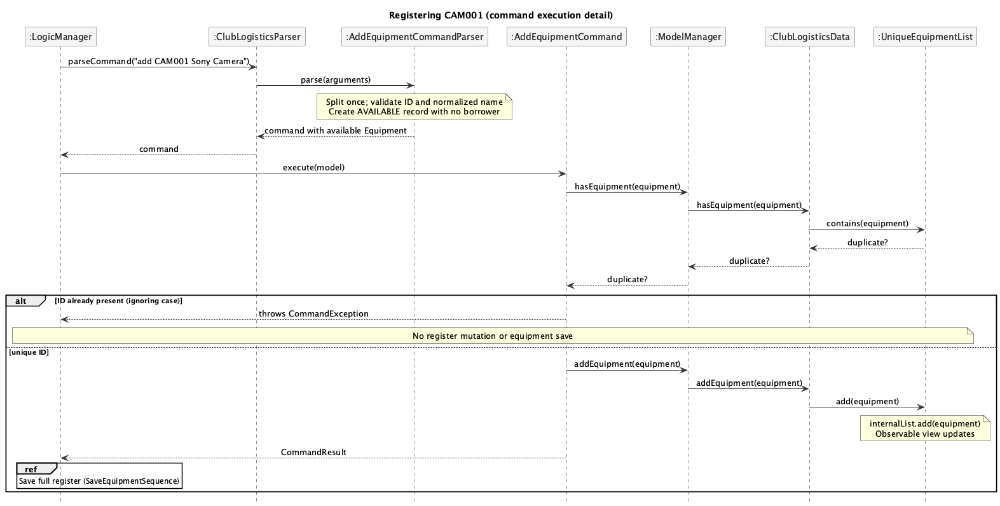

The duplicate branch reports `Error: Equipment with ID CAM001 already exists.` before adding or saving.
Missing ID/name tokens produce usage feedback; invalid values produce the corresponding value-type
constraint message. Names are descriptive rather than unique: `add CAM002 Sony Camera` is valid alongside
`CAM001`, because each physical item has its own ID. Starting new equipment as available avoids inventing
a borrower during registration. Central value types and the unique list protect the same invariants for
both commands and loaded data, at the cost of validating some inputs at more than one layer.

An active `filter issued` still hides a newly added available item; registration does not reset the view.


### Removing equipment

For `remove cam001`, `RemoveCommandParser` requires exactly one token and constructs an `EquipmentId`.
Invalid IDs report the ID constraint; missing or extra tokens report
`Error: Invalid command format. Usage: remove <equipment-id>`.
`RemoveCommand` calls `model.findEquipment`, delegated through `ClubLogisticsData.findEquipment` to
`UniqueEquipmentList.find`, which compares IDs without case sensitivity.

If the stored record is available `CAM001`, the command calls `ModelManager.removeEquipment`, then
`ClubLogisticsData.removeEquipment`, then `UniqueEquipmentList.remove`. The observable list and filtered
view lose that record before Logic saves; feedback uses the stored spelling:
`Equipment CAM001 removed successfully.`. Other records remain unchanged.

The [architecture interaction diagram](#architecture) shows the successful removal and save pipeline.

A missing ID produces `Error: Equipment with ID cam001 does not exist.`. If `CAM001` is issued to John Tan,
the command instead reports `Error: Equipment CAM001 is issued to John Tan and cannot be removed.`.
Both checks precede mutation and saving. The coordinator must return the equipment before removing it.
This preserves the borrower assignment while equipment is outstanding. IDs target physical assets
independently of their display order or filter; targeting a visible index would couple removal to view state.


### Listing equipment

`ClubLogisticsParser` routes `list` to `ListCommandParser`, which accepts only blank arguments; `list extra`
produces `Error: Invalid command format. Usage: list`. `ListCommand.execute` calls
`ModelManager.updateFilteredEquipmentList(PREDICATE_SHOW_ALL_EQUIPMENT)`, which sets the predicate on the
existing `FilteredList`. It does not copy or modify equipment records. The panel observes the changed view,
and `ResultDisplay` receives `Listed all equipment.`. After resetting the predicate, an empty view means
the entire register is empty, so the command returns `No equipment found.` instead.

For example, with available `CAM001` and issued `MIC001`, `filter issued` shows only `MIC001`; `list` then
shows both. A previously empty filtered result is not evidence of an empty register: `list` can reveal
records of the other status. Using a single view avoids maintaining separate result lists and lets later
record changes update the same binding. Logic still saves the unchanged register after successful `list`.


### Filtering by status

For `filter available`, `FilterCommandParser` requires exactly one token and converts it with
`toUpperCase(Locale.ROOT)` to `EquipmentStatus`. `AVAILABLE` and `ISSUED` are accepted regardless of letter
case; missing, unsupported, or extra tokens produce
`Error: Invalid command format. Usage: filter <available|issued>`.
`FilterCommand` installs a predicate comparing each record's `getStatus()` with the selected enum.
`ModelManager.updateFilteredEquipmentList` calls `FilteredList.setPredicate`; the source register stays intact.

| Selected filter | At least one match | No matches |
| --- | --- | --- |
| available | `Showing available equipment.` | `No available equipment found.` |
| issued | `Showing issued equipment.` | `No issued equipment found.` |

The messages describe the result when the filter command executes. Subsequent record changes update the
cards automatically, without rerunning the filter command or regenerating its feedback.

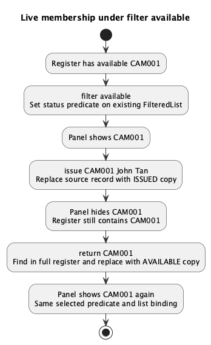

In this worked example, `CAM001` starts available. `filter available` includes it; `issue CAM001 John Tan`
replaces it with an issued record, so it disappears. `return CAM001` finds the hidden record in the full
register and replaces it with an available one, so it reappears. Under `filter issued`, the same changes
have the opposite effect. Adds, removals, replacements, and clear also update membership through the source
list. Another `filter` replaces the predicate; `list` restores the show-all predicate.

A derived observable view avoids synchronising a separate filtered collection after every command.
The predicate is session state only: the JSON snapshot contains the complete register, and neither equipment
storage nor preferences serialize the filter. A restart creates a new unfiltered view. Successful `filter`
still passes through the shared save step.

### Issuing equipment

For `issue CAM001 John Tan`, `IssueCommandParser` splits the trimmed arguments once into ID and complete
borrower name. `BorrowerName` trims and collapses consecutive ordinary spaces and accepts 1–50 ASCII letters
and spaces, beginning with a letter. Thus `John   Tan` becomes `John Tan`; digits, punctuation, and embedded
tabs are invalid. Missing fields produce the issue usage message; invalid ID/name values produce their
constraint messages. The parser creates `IssueCommand(EquipmentId, BorrowerName)`.

`IssueCommand` looks up the item through `ModelManager.findEquipment` in the full register, ignoring ID case.
For an available item, `Equipment.issueTo(borrower)` returns a new record with the same ID/name,
`ISSUED` status, and the borrower. `ModelManager.setEquipment` delegates through `ClubLogisticsData` to
`UniqueEquipmentList.set`, which replaces the item at its existing position. The observable and filtered
views update, and Logic saves the replacement.

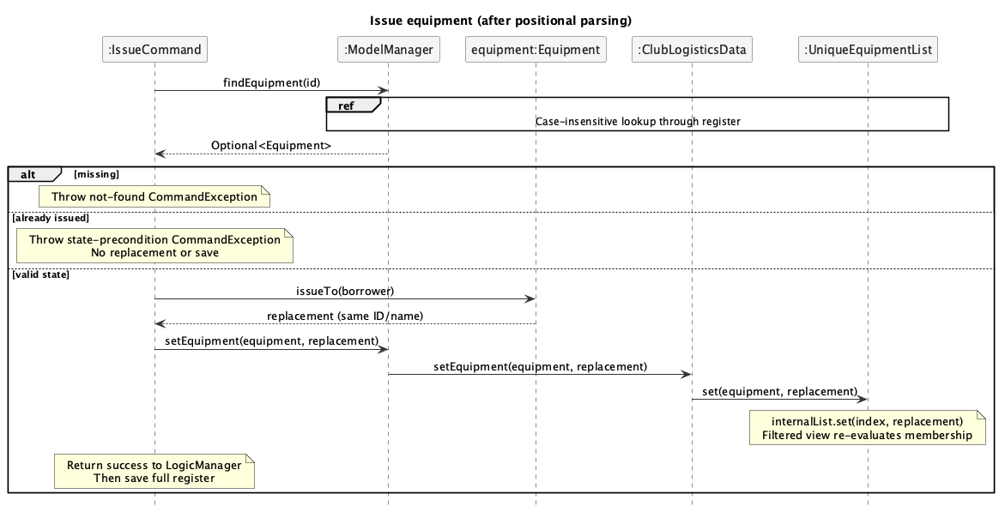

The successful feedback is:

```text
Equipment CAM001 issued to John Tan.
CAM001 | Sony Camera | Issued to: John Tan
```

A missing item reports `Error: Equipment with ID CAM001 does not exist.`. Reissuing the example item reports
`Error: Equipment CAM001 is already issued to John Tan.` before replacement or saving, preserving John Tan
even if the attempted new borrower differs. `Equipment.issueTo` also rejects an issued record defensively.
The `Equipment` constructor enforces that `ISSUED` has a borrower and `AVAILABLE` does not.

Immutable replacement keeps status and borrower consistent as one record and generates an observable list
change; mutable fields would need their own coordinated notifications. Borrowers are names attached to
individual equipment records, so there is no separate person register or cross-record borrower uniqueness.
John Tan may hold both `CAM001` and `MIC001`; this model stores current assignments without identifying
people beyond their names.

### Returning equipment

`return CAM001` follows `ClubLogisticsParser` → `ReturnCommandParser` → `ReturnCommand`. The parser requires
one valid equipment ID, rejecting missing/extra arguments with the return usage message. The command finds
the item case-insensitively in the full register and checks `isIssued()` before calling `Equipment.markReturned`.
That method returns a new available record retaining ID/name and clearing the borrower.
`ModelManager.setEquipment` → `ClubLogisticsData.setEquipment` → `UniqueEquipmentList.set` replaces the record,
updates observers under the active predicate, and hands the register back to Logic for saving.

Return follows the [issue interaction diagram](#issuing-equipment), replacing the available-state check
with an issued-state check and calling `markReturned()` instead of `issueTo(borrower)`.

After returning the issued example above, feedback is:

```text
Equipment CAM001 returned successfully.
CAM001 | Sony Camera | Available
```

A missing item reports `Error: Equipment with ID CAM001 does not exist.`. An already available item reports
`Error: Equipment CAM001 is not currently issued.`; neither rejection changes records or reaches saving.
`markReturned` also checks the state defensively. As with issue, immutable replacement gives observers a
single consistent status/borrower update. Return makes later reissue or removal possible. It does not retain
loan history, return dates, or return condition: only the latest availability and borrower are represented.


### Clearing the register

`ClubLogisticsParser` dispatches `clear` through `ClearCommandParser`, which rejects nonblank arguments with
`Error: Invalid command format. Usage: clear`. `ClearCommand.execute` supplies a new empty
`ClubLogisticsData` to `ModelManager.setClubLogisticsData`. The manager calls `resetData` on its existing
register; `ClubLogisticsData.setEquipments` delegates to `UniqueEquipmentList.setEquipment`. That method
validates the replacement collection in a temporary unique list and uses `internalList.setAll` to replace
contents, preserving the observable list and its observers. The existing filter predicate remains selected,
with no matching records after clear.

For example, a register containing available `CAM001` and issued `MIC001` becomes empty, even if
`filter available` previously hid `MIC001`. Feedback is `ClubLogistics data has been cleared!`. Logic saves
`{"equipment": []}`, so restarting loads an empty register rather than missing-file sample data.
Unlike `remove`, clear has no per-item issued-state protection: it intentionally resets all records,
including borrower assignments. It provides no confirmation step, undo, or retained loan history.
Resetting contents through the shared register API avoids replacing the model/list objects bound to the UI.


### Saving and loading equipment data

#### Startup and recovery

`MainApp.init` creates `JsonUserPrefsStorage`, loads preferences, and creates `JsonClubLogisticsStorage` and
`StorageManager`. `initModelManager` calls `StorageManager.readClubLogisticsData`, delegated to the JSON
storage. `JsonUtil.readJsonFile` deserializes with Jackson; `JsonSerializableClubLogisticsData.toModelType`
adapts each `JsonAdaptedEquipment` and checks ID uniqueness while constructing a separate register.
`ModelManager` copies the resulting data and creates its filtered view before Logic and UI are connected.

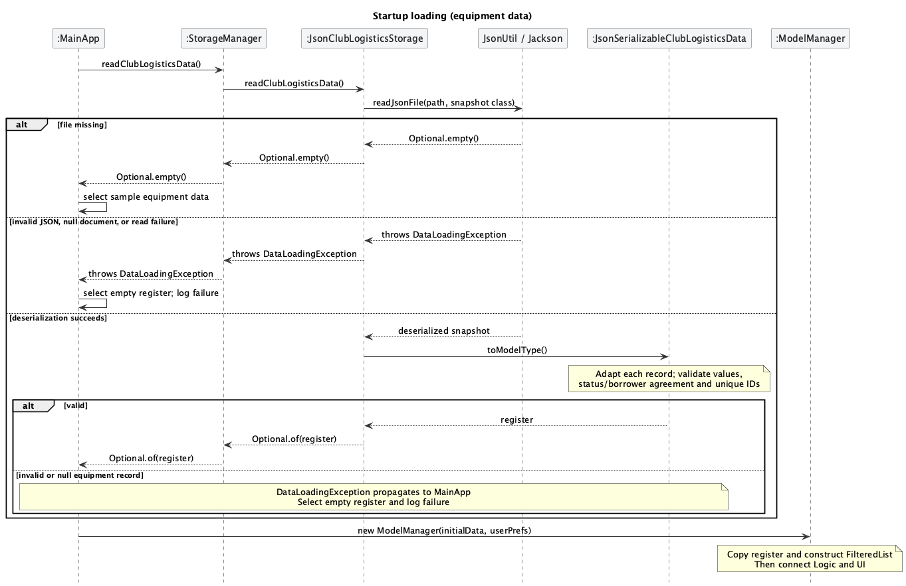

A missing file yields `Optional.empty()` and `MainApp` selects `SampleDataUtil.getSampleClubLogisticsData`.
Malformed JSON, unreadable data, a literal JSON `null` document, null equipment records, or invalid records
raise `DataLoadingException`; `MainApp` logs the failure and starts with an empty register. A bad later record
does not load a valid prefix of the file. An existing object with absent/null `equipment` is accepted as an
empty register. Recovery selects in-memory startup data; it does not repair or back up an invalid file.

#### Saving and the persisted schema

After a successful data command (including `list` and `filter`), `LogicManager` calls
`StorageManager.saveClubLogisticsData`, which delegates to `JsonClubLogisticsStorage`.
The latter constructs a `JsonSerializableClubLogisticsData` snapshot without creating an empty destination file.
Each `JsonAdaptedEquipment` copies the record's scalar fields. `JsonUtil.saveJsonFile` serializes the snapshot
with Jackson before asking `FileUtil` to save it. `help` and `exit` skip this equipment save, so they remain usable when writes
fail. Command success is returned only after the save succeeds. On `IOException`, Logic restores the
pre-command register through `model.setClubLogisticsData` and reports the storage error; observers and the
selected predicate survive that reset.

`FileUtil.writeToFile` creates any missing parent folders and writes a temporary file in the destination
directory. It flushes that file through `FileChannel.force(true)` and closes the channel before requesting
`Files.move` with `ATOMIC_MOVE` and `REPLACE_EXISTING`. The live destination is never opened for truncation;
readers see the complete old or new file. Read-only destinations are rejected before staging. A failed save
removes its staging file when possible; cleanup failures are attached to the original exception.

Windows refuses to replace a file while another process, such as antivirus or a sync client, has it open, and
reports this as `AccessDeniedException`. The move is therefore retried up to 20 times, 25 ms apart (about half a
second in total), before the save is reported as failed. A directory at the destination fails immediately
because waiting cannot fix it. Other platforms replace open files directly, so the retry does not trigger there.

The filesystem must support atomic replacement. An unsupported or failed move reports an error without a
non-atomic fallback. Both equipment data and preferences use this writer. Abrupt process termination can leave
an unused `.clublogistics-*.tmp` file; startup still reads only the normal JSON filenames. This is not a backup
system or a guarantee against power loss and storage-device failure; no directory synchronisation is performed.

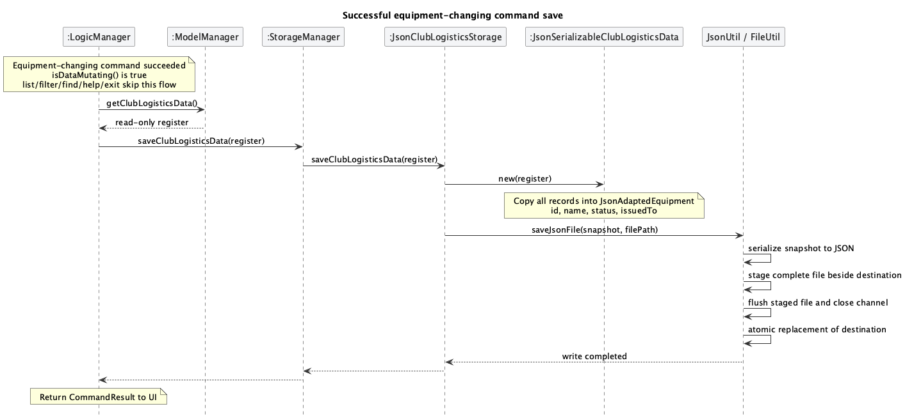

For `add CAM001 Sony Camera` → `issue CAM001 John Tan` → restart, the final saved equipment entry is:

```json
{
  "equipment": [
    { "id": "CAM001", "name": "Sony Camera", "status": "ISSUED", "issuedTo": "John Tan" }
  ]
}
```

The restarted model therefore contains `CAM001 | Sony Camera | Issued to: John Tan`. The schema contains
no contact register, filter predicate, or loan history. Explicit status values are case-sensitive enum names:
`AVAILABLE` requires null/empty `issuedTo`, while `ISSUED` requires a valid borrower. Missing/null `status`
is accepted for compatibility and inferred from the borrower; saving always writes an explicit status.
IDs and names are required and validated by the same value types as commands; duplicate IDs (ignoring case),
invalid borrowers/statuses, inconsistent status/borrower pairs, and null records reject the load.

For a packaged application, `AppPaths` resolves the home folder from its class code-source JAR location.
Equipment uses `data/clublogistics.json`, preferences use `preferences.json`, and logging uses
`clublogistics.log` files inside that folder, independently of the launch directory. Class-directory launches
during development use the working directory. `MainApp.initPrefs` loads/defaults and saves preferences at
startup, while `MainApp.stop` saves them on shutdown. Equipment is saved during command execution rather
than waiting for shutdown. If file logging cannot start, console logging remains available. No migration from
another filename is performed. External edits are read on the
next startup only; a successful saving command in the running session writes its in-memory register to the file.
Help and exit do not save equipment data.

Storage adapters isolate Jackson's representation and compatibility rules from immutable domain objects.
The copied serialization snapshot is independent of later changes to the model, but does not provide
concurrent editing or a transaction spanning equipment and preferences. `JsonAdaptedEquipmentTest`,
`JsonSerializableClubLogisticsDataTest`, and `JsonClubLogisticsStorageTest` exercise schema validation,
null inputs, duplicates, and round trips. `IssueCommandIntegrationTest`, `ReturnCommandIntegrationTest`,
`ClearCommandIntegrationTest`, and `FilterCommandIntegrationTest` verify persisted command outcomes and
restart behavior; `LogicManagerTest` checks the save handoff and storage error reporting. `FileUtilTest` checks
complete-file visibility, failed replacement cleanup, missing folders and read-only protection.

## **Documentation, logging, testing, dev-ops**

* [Documentation guide](Documentation.md)
* [Testing guide](Testing.md)
* [Logging guide](Logging.md)
* [DevOps guide](DevOps.md)

## **Appendix: Requirements**

### Product scope

**Target user profile**:

ClubLogistics is intended for a **student-club logistics coordinator** who:

* is the single person responsible for maintaining the club's equipment register.
* tracks individual reusable assets, such as speakers, microphones, cameras, projectors, and extension reels.
* needs to know what equipment exists, where it is stored, whether it is usable and available, and who is responsible for borrowed equipment.
* performs many short updates and retrieves records quickly, especially while preparing for events, issuing or receiving equipment, conducting stocktakes, and handing over the role.
* can type quickly, prefers keyboard-driven workflows, and is comfortable entering text commands in a desktop application.

ClubLogistics does not target the management of consumables or bulk stock. It also excludes member accounts, concurrent editing, cloud synchronisation, remote servers, and barcode or QR-code scanning as a required workflow.

**Value proposition**: ClubLogistics keeps a student club's equipment records organised and quick to retrieve through a typing-first workflow, reducing misplaced equipment, missed returns, and uncertainty about availability and condition.


### User stories

Priorities: High (must have) - `* * *`, Medium (nice to have) - `* *`, Low (unlikely to have) - `*`.

The stories below describe the full product vision. They include deferred capabilities that might not be implemented in the final course release.

| ID | Priority | As a …​ | I want to …​ | So that I can …​ |
| -- | -------- | ------- | ------------- | ----------------- |
| US01 | `* * *` | logistics coordinator | add a reusable asset with enough information to identify, locate, and assess it | record new equipment consistently |
| US02 | `* * *` | logistics coordinator | view all recorded assets | understand what equipment the club owns |
| US03 | `* *` | logistics coordinator | view the details of one asset | check its current state before acting on it |
| US04 | `* * *` | logistics coordinator | find an asset by its ID or name | retrieve its record quickly during a handover or loan |
| US05 | `* *` | logistics coordinator | filter assets by category | focus on the type of equipment needed for an event |
| US06 | `* *` | logistics coordinator | filter assets by availability | see which equipment can be issued now |
| US07 | `* *` | logistics coordinator | change an asset's storage location | keep the register accurate when equipment is moved |
| US08 | `* *` | logistics coordinator | correct an asset's recorded details | prevent typing mistakes from remaining in the register |
| US09 | `* * *` | logistics coordinator | remove an asset that was entered by mistake | prevent an incorrect record from cluttering the register |
| US10 | `*` | logistics coordinator | archive an asset that has been disposed of | retain its history without showing it as usable |
| US11 | `* * *` | logistics coordinator | record a loan with a borrower and due date | know who is responsible for an asset and when it should return |
| US12 | `* * *` | logistics coordinator | view all active loans | monitor equipment that is outside storage |
| US13 | `* * *` | logistics coordinator | record the return of a loaned asset | make the asset available again |
| US14 | `* *` | logistics coordinator | view overdue loans | follow up on late returns first |
| US15 | `* *` | logistics coordinator | find active loans by borrower name | handle a borrower's return without checking every loan |
| US16 | `* *` | logistics coordinator | extend an active loan's due date | reflect an approved extension accurately |
| US17 | `* *` | logistics coordinator | cancel a loan recorded by mistake | avoid making an available asset appear unavailable |
| US18 | `*` | logistics coordinator | view an asset's previous loans | investigate repeated loss, damage, or late returns |
| US19 | `*` | logistics coordinator | view a borrower's previous loans | understand their borrowing history before issuing valuable equipment |
| US20 | `* *` | logistics coordinator | add a short purpose or event note to a loan | remember why the equipment was issued |
| US21 | `* *` | logistics coordinator | record an asset's condition when adding it | establish the equipment's starting condition |
| US22 | `* *` | logistics coordinator | record an asset's condition when it is returned | avoid overlooking damage discovered during return |
| US23 | `* * *` | logistics coordinator | mark an asset as damaged | prevent unsafe or unusable equipment from being issued |
| US24 | `* *` | logistics coordinator | list all damaged assets | plan repairs and replacements |
| US25 | `* *` | logistics coordinator | add a note describing reported damage | make the repair issue clear to whoever handles it later |
| US26 | `* *` | logistics coordinator | mark a damaged asset as usable after repair | return repaired equipment to the available pool |
| US27 | `* *` | logistics coordinator | record that an asset is missing | avoid promising equipment that cannot be found |
| US28 | `* *` | logistics coordinator | record a maintenance due date | arrange servicing before equipment fails during an event |
| US29 | `* *` | logistics coordinator | view counts of available, loaned, damaged, and missing assets | assess equipment readiness quickly |
| US30 | `* *` | logistics coordinator | sort assets by name, category, location, or condition | review a large register in a useful order |
| US31 | `* *` | logistics coordinator | view assets stored at a particular location | prepare equipment without searching every storage area |
| US32 | `*` | logistics coordinator | tag assets for an activity or event type | identify suitable equipment even when categories differ |
| US33 | `* *` | logistics coordinator | add private handling or setup notes to an asset | keep important operational details with its record |
| US34 | `*` | logistics coordinator | view recent changes to assets and loans | understand what happened since the last inventory check |
| US35 | `*` | logistics coordinator | export a human-readable inventory list | conduct a physical stocktake or share a handover snapshot |
| US36 | `* *` | logistics coordinator | export active and overdue loans | use the list for follow-up and committee handover |
| US37 | `*` | logistics coordinator | back up the club's equipment records | avoid losing the register if the device or file is lost |
| US38 | `*` | logistics coordinator | restore records from a backup | recover the register after data loss |
| US39 | `* *` | new logistics coordinator | review unresolved loans, missing assets, and damaged assets | take over the role without overlooking existing problems |
| US40 | `* *` | logistics coordinator | see when each asset record was last updated | identify information that may be stale |

### Use cases

(For all use cases below, the **System** is `ClubLogistics` and the **Actor** is the logistics coordinator.)

The use cases below describe the product vision, not only the released commands. Each use case is labelled with
its release status. The implemented release supports `add`, `remove`, `list`, `filter`, `issue`, `return`,
`clear`, `help`, and `exit`; refer to the [User Guide](UserGuide.md) for their exact command formats.

#### Use case UC01: Register a new asset

**Release status: Partially implemented.** The release supports registering an item with an equipment ID and name
using `add`. It records the new item as available. Storage location and condition are planned capabilities.

**MSS**

1. Coordinator requests to add an asset and provides its identifying details, storage location, and condition.
2. ClubLogistics validates the supplied details and checks that the equipment ID is unique.
3. ClubLogistics records the asset as available.
4. ClubLogistics displays the new asset record.

    Use case ends.

**Extensions**

* 2a. The equipment ID or another required field is invalid.
  * 2a1. ClubLogistics shows the invalid field and its requirements.
  * 2a2. Coordinator corrects the details.
  * Steps 2-4 are repeated.
* 2b. An asset with the same equipment ID already exists.
  * 2b1. ClubLogistics rejects the request and displays the existing asset.

    Use case ends.

#### Use case UC02: Issue an asset to a borrower

**Release status: Partially implemented.** The release supports `issue <equipment-id> <borrower-name>` for an
available item. Searching by name, due dates, purpose, and loan records are planned capabilities.

**Preconditions**: The asset exists and is available and usable.

**MSS**

1. Coordinator searches for the asset by equipment ID or name.
2. ClubLogistics displays matching assets and their availability and condition.
3. Coordinator selects an asset and provides the borrower's details, due date, and an optional purpose.
4. ClubLogistics validates the loan details.
5. ClubLogistics creates an active loan and marks the asset as loaned.
6. ClubLogistics displays the recorded borrower and due date.

    Use case ends.

**Extensions**

* 2a. No matching asset exists.
  * 2a1. ClubLogistics informs the coordinator that no asset was found.

    Use case ends.
* 4a. The asset is already loaned, damaged, missing, or archived.
  * 4a1. ClubLogistics rejects the loan and displays why the asset cannot be issued.

    Use case ends.
* 4b. The borrower details or due date are invalid.
  * 4b1. ClubLogistics shows the invalid field and its requirements.
  * 4b2. Coordinator corrects the loan details.
  * Steps 4-6 are repeated.

#### Use case UC03: Receive an asset and record damage

**Release status: Partially implemented.** The release supports `return <equipment-id>`, which clears the
borrower and makes an issued item available. Recording damage, loan records, and condition are planned
capabilities.

**Preconditions**: The asset has an active loan.

**MSS**

1. Coordinator finds the active loan by equipment ID or borrower name.
2. ClubLogistics displays the matching active loan.
3. Coordinator records the return and the asset's condition.
4. ClubLogistics closes the loan and marks the asset as available.
5. ClubLogistics displays the updated asset and loan records.

    Use case ends.

**Extensions**

* 2a. No active loan matches the search.
  * 2a1. ClubLogistics informs the coordinator that no active loan was found.

    Use case ends.
* 3a. The asset is damaged.
  * 3a1. Coordinator records a damage description.
  * 3a2. ClubLogistics closes the loan, marks the asset as damaged and unavailable, and saves the description.
  * Use case resumes at step 5.

#### Use case UC04: Prepare equipment for an event

**Release status: Planned.** The release can only filter the register by `available` or `issued` status. Category,
event-tag, storage-location, condition, count, and detailed-record workflows are planned capabilities.

**MSS**

1. Coordinator requests assets for a category, event tag, or storage location.
2. ClubLogistics displays the matching assets with their availability and condition.
3. Coordinator filters the results to assets that are available and usable.
4. ClubLogistics displays the suitable assets and a count of the results.
5. Coordinator views a selected asset's details to confirm its location and handling notes.
6. ClubLogistics displays the selected asset's full record.

    Use case ends.

**Extensions**

* 4a. No suitable asset is available.
  * 4a1. Coordinator requests matching assets that are loaned, damaged, or missing.
  * 4a2. ClubLogistics displays their state and, where applicable, borrower and due-date information.

    Use case ends.

#### Use case UC05: Hand over the logistics role

**Release status: Planned.** The release does not provide unresolved-loan summaries, asset history, exports, or
backup commands. Equipment data is retained locally in `data/clublogistics.json` after successful commands.

**MSS**

1. Coordinator requests a summary of unresolved loans, damaged assets, and missing assets.
2. ClubLogistics displays the outstanding items and recent changes.
3. Coordinator requests exports of the inventory and active or overdue loans.
4. ClubLogistics creates human-readable export files.
5. Coordinator creates a backup of the equipment records.
6. ClubLogistics confirms that the backup was created successfully.

    Use case ends.

**Extensions**

* 4a. An export cannot be written to the selected location.
  * 4a1. ClubLogistics reports the error without changing any records.
  * 4a2. Coordinator selects another writable location.
  * Steps 4-6 are repeated.

### Non-Functional Requirements

These include goals for the broader product vision. References to condition tracking, search, loan history,
and export apply to planned capabilities; they do not claim that those features exist in this release.
The User Guide describes the implemented commands and current limitations.

1. **NFR01 - Platform independence:** ClubLogistics should work on Windows, Linux, and macOS on a computer with Java `25` installed.
2. **NFR02 - Portability:** ClubLogistics should run without an installer and should be distributed as a single JAR file no larger than 100 MB.
3. **NFR03 - Single-user operation:** ClubLogistics should support one logistics coordinator and should not require user accounts, concurrent editing, or shared access to its live data file.
4. **NFR04 - Local and durable storage:** ClubLogistics should store all operational data locally in a human-editable text file, should not require a DBMS or remote server, and should retain successful changes after the application is closed and restarted.
5. **NFR05 - Offline availability:** All core asset, loan, condition, and search functions should remain usable without an Internet connection or third-party account.
6. **NFR06 - Performance:** With up to 1,000 asset records and 5,000 loan-history records, ClubLogistics should complete common commands such as add, find, list, issue, and return within one second on a typical modern laptop, excluding application start-up and file export time.
7. **NFR07 - Typing-first usability:** Every product function should be accessible using text commands. A user with above-average typing speed should be able to complete common workflows faster than with an equivalent mouse-only workflow.
8. **NFR08 - Learnability and feedback:** Command formats and validation errors should state what input is required, and every command should provide a clear success or failure message without silently changing data.
9. **NFR09 - Data integrity:** Equipment IDs should uniquely identify physical assets regardless of letter case. ClubLogistics should reject operations that would create contradictory records, such as issuing an unavailable asset, returning an available asset, or removing an asset with an active loan.
10. **NFR10 - Screen compatibility:** The GUI should work well at resolutions of 1920x1080 and above at 100% and 125% scaling, and remain fully usable at resolutions of 1280x720 and above at 150% scaling.
11. **NFR11 - Privacy:** Borrower details and private asset notes should remain on the user's device unless the user explicitly exports or copies them.
12. **NFR12 - Recoverability:** A failed command, failed export, or interrupted save should not partially apply an operation or corrupt the last valid stored data.

### Glossary

* **Active loan**: A loan that has been issued and has not yet been returned or cancelled.
* **Archived asset**: An asset retained for historical reference but excluded from the usable equipment register.
* **Asset**: One individually tracked, reusable piece of club equipment. Each physical item is a separate asset even when several items have the same name.
* **Available asset**: An asset that is usable, not archived, not missing, and not part of an active loan.
* **Borrower**: The person currently responsible for an asset that has been issued.
* **Category**: A broad classification of an asset by equipment type, such as audio, video, or power.
* **CLI (Command Line Interface)**: A text-command interface through which the user invokes ClubLogistics functions.
* **Condition**: The recorded physical or operational state of an asset, such as usable or damaged.
* **Due date**: The date by which an active loan is expected to be returned.
* **Equipment ID**: A case-insensitive, unique identifier assigned to one physical asset.
* **Equipment register**: The complete collection of asset records maintained by ClubLogistics.
* **Event tag**: A user-defined label that groups assets suitable for an activity or event type independently of category.
* **Loan**: A record that an asset was issued to a borrower, including its issue status and expected return date.
* **Logistics coordinator**: The single user responsible for maintaining the club's equipment register.
* **Missing asset**: An asset whose current physical location is unknown and which cannot be issued.
* **Overdue loan**: An active loan whose due date has passed.
* **Private note**: Handling, setup, or other operational information intended only for the logistics coordinator.
* **Stocktake**: A physical check of recorded assets against the equipment actually present.
* **Storage location**: The place where an asset is normally kept when it is not on loan.
* **Usable asset**: An asset whose recorded condition permits it to be issued; it may still be unavailable because it is currently on loan.

--------------------------------------------------------------------------------------------------------------------

## **Appendix: Instructions for manual testing**

### Launch and shutdown

1. Build `clublogistics.jar` with `./gradlew shadowJar` using Java 25 and copy it into an empty folder.
2. Run `java -jar clublogistics.jar`. Expect available sample equipment `CAM001`, `MIC001`, and `PROJ001`.
3. Resize and move the window, exit, and relaunch. Expect the window size and position to be retained.

### Equipment lifecycle and filtering

1. Run `add TRI001 Tripod`, then `filter available`. Expect the tripod to appear as available.
2. Run `issue TRI001 John Tan`. Expect it to disappear from the available view.
3. Run `filter issued`. Expect the tripod to show `Issued to: John Tan`.
4. Run `remove TRI001`. Expect an error and no changes because the item is issued.
5. Run `return TRI001`, then `list`. Expect the tripod to be available.
6. Run `remove tri001`. Expect only the tripod to be removed, regardless of ID capitalization.
7. Run `clear`. Expect an empty equipment register.

### Saving data and reporting errors

1. Add equipment, issue it, exit, and relaunch. Expect the item and borrower to be retained.
2. With the app closed, check `data/clublogistics.json`. Expect only an `equipment` array at the top level.
3. In a disposable test folder, replace the data file with invalid JSON and launch the app. Expect an empty register.
   Help and exit leave the equipment file untouched; other successful commands replace it when saving.
   Back up the invalid file before running saving commands.
4. Run `help`. Expect the ClubLogistics User Guide link.
5. Try an invalid equipment ID or an unknown command. Expect an error without changing any records.
