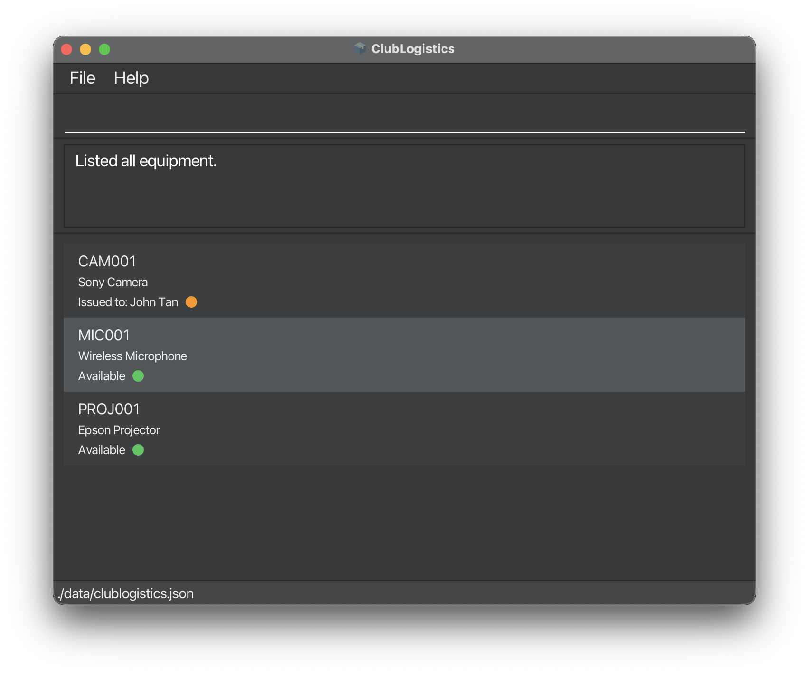

ClubLogistics Level 3 (AB3) is a **desktop application for managing contacts, optimized for use through a Command Line Interface (CLI)** while retaining the benefits of a Graphical User Interface (GUI). If you type quickly, AB3 can help you manage contacts faster than traditional GUI applications.

* Table of Contents
{:toc}

--------------------------------------------------------------------------------------------------------------------

## Quick start

1. Ensure that Java `25` or later is installed on your computer.<br>
   **Mac users:** Ensure you have the precise JDK version prescribed [here](https://se-education.org/guides/tutorials/javaInstallationMac.html).

1. Download the latest `.jar` file from [here](https://github.com/se-edu/addressbook-level3/releases).

1. Copy the file to the folder you want to use as the _home folder_ for your ClubLogistics.

1. Open a terminal, `cd` to the folder containing the JAR file, and run `java -jar addressbook.jar`.<br>
   A GUI similar to the one below should appear in a few seconds. Note how the app contains some sample data.<br>
   

1. Type a command in the command box and press Enter to execute it. For example, type **`help`** and press Enter to open the help window.<br>
   Some example commands you can try:

   * `list` : Lists all registered equipment.

   * `add CAM001 Sony Camera` : Registers a Sony Camera with equipment ID `CAM001`.

   * `delete 3` : Deletes the 3rd contact shown in the current list.

   * `clear` : Deletes all contacts.

   * `exit` : Exits the app.

1. Refer to the [Features](#features) section below for details of each command.

--------------------------------------------------------------------------------------------------------------------

## Features

<div markdown="block" class="alert alert-info">

**:information_source: Notes about the command format:**<br>

* Words in `UPPER_CASE` are the parameters to be supplied by the user.<br>
  For example, in `add EQUIPMENT_ID EQUIPMENT_NAME`, use `add CAM001 Sony Camera`.

* Items in square brackets are optional.<br>
  For example, `n/NAME [t/TAG]` can be used as `n/John Doe t/friend` or as `n/John Doe`.

* Items followed by `…`​ can appear zero or more times.<br>
  For example, `[t/TAG]…​` may be omitted, or written as `t/friend` or `t/friend t/family`.

* Prefixed parameters can be in any order.<br>
  For example, if the command specifies `n/NAME p/PHONE_NUMBER`, `p/PHONE_NUMBER n/NAME` is also acceptable.

* Extraneous parameters for commands that take no parameters, such as `help`, `list`, `exit`, and `clear`, are ignored.<br>
  For example, `help 123` is interpreted as `help`.

* If you are using a PDF version of this document, be careful when copying and pasting commands that span multiple lines as space characters surrounding line-breaks may be omitted when copied over to the application.
</div>

### Viewing help: `help`

Shows a message explaining how to access the help page.


Format: `help`


### Adding equipment: `add`

Registers an equipment item and displays it immediately in the Equipment panel.

Format: `add EQUIPMENT_ID EQUIPMENT_NAME`

* IDs contain 1–20 letters or digits. IDs are unique regardless of case:
  `CAM001` and `cam001` refer to the same equipment.
* Names contain 1–50 characters after whitespace is normalised. Names can
  contain spaces, and different items may share a name.
* New equipment has the status `Available` and is saved automatically alongside contacts.
* Contact-style input such as `add n/NAME p/PHONE_NUMBER` is not supported.

Example: `add CAM001 Sony Camera`

### Issuing equipment: `issue`

Records who currently holds an available equipment item.

Format: `issue <equipment-id> <person-name>`

* Supply the equipment ID first. All text after the ID is treated as the person's name, including spaces.
* Equipment IDs contain 1–20 letters or digits and are matched without regard to capitalization.
* Person names contain 1–50 letters or spaces. Leading and trailing spaces are removed, and consecutive spaces
  are combined. Digits and punctuation are rejected.
* An item must exist and be available. Issuing an item that is already issued is rejected, preserving its current holder.
* Different items can be issued to the same person. You do not need to add the person as a contact first.
* The current holder is saved automatically and retained when the application restarts.

Example: `issue cam001 John Tan`

Successful output:

```text
Equipment CAM001 issued to John Tan.
CAM001 | Sony Camera | Issued to: John Tan
```

On a fresh installation without a saved data file, `CAM001`, `MIC001`, and `PROJ001` are available sample equipment.
Use `add` to register equipment and `list` to show all equipment.
To try issuing equipment with an existing data file, see [Editing the data file](#editing-the-data-file).

### Returning equipment: `return`

Records that an issued equipment item has been returned, making it available again.

Format: `return <equipment-id>`

* Equipment IDs contain 1–20 letters or digits and are matched without regard to capitalization.
* The item must exist and be currently issued. Returning an item that is already available is rejected.
* After a successful return, the item is no longer associated with its previous holder.
* The updated status is saved automatically and retained when the application restarts.

Example: `return cam001`

Successful output:

```text
Equipment CAM001 returned successfully.
CAM001 | Sony Camera | Available
```

### Listing all equipment: `list`

Shows the ID, name and status of every equipment item in the equipment register.

Format: `list`

### Editing a person: `edit`

Edits an existing person in the address book.

Format: `edit INDEX [n/NAME] [p/PHONE] [e/EMAIL] [a/ADDRESS] [t/TAG]…​`

* Edits the person at the specified `INDEX`. The index refers to the index number shown in the displayed person list. The index **must be a positive integer** 1, 2, 3, …​
* At least one of the optional fields must be provided.
* Existing values will be updated to the input values.
* When editing tags, all of the person's existing tags are removed; adding tags is not cumulative.
* To remove all of a person's tags, enter `t/` without a tag after it.

Examples:
*  `edit 1 p/91234567 e/johndoe@example.com` Edits the phone number and email address of the 1st person to be `91234567` and `johndoe@example.com` respectively.
*  `edit 2 n/Betsy Crower t/` Edits the name of the 2nd person to be `Betsy Crower` and clears all existing tags.

### Locating persons by name: `find`

Finds persons whose names contain any of the given keywords.

Format: `find KEYWORD [MORE_KEYWORDS]`

* The search is case-insensitive; for example, `hans` matches `Hans`.
* Keyword order does not matter; for example, `Hans Bo` matches `Bo Hans`.
* The search considers only names.
* Only full words match; for example, `Han` does not match `Hans`.
* Persons matching at least one keyword are returned (an `OR` search); for example, `Hans Bo` returns `Hans Gruber` and `Bo Yang`.

Examples:
* `find John` returns `john` and `John Doe`
* `find alex david` returns `Alex Yeoh`, `David Li`<br>
  

### Deleting a person: `delete`

Deletes the specified person from the address book.

Format: `delete INDEX`

* Deletes the person at the specified `INDEX`.
* The index refers to the index number shown in the displayed person list.
* The index **must be a positive integer** 1, 2, 3, …​

Examples:
* `list` followed by `delete 2` deletes the 2nd person in the address book.
* `find Betsy` followed by `delete 1` deletes the 1st person in the results of the `find` command.

### Clearing all entries: `clear`

Clears all contacts and equipment from the address book.

Format: `clear`

### Exiting the program: `exit`

Exits the program.

Format: `exit`

### Saving the data

ClubLogistics automatically saves data after every command. You do not need to save manually.

### Editing the data file

ClubLogistics data is saved automatically as a JSON file `[JAR file location]/data/addressbook.json`. Advanced users are welcome to update data directly by editing that data file.

Equipment is stored in the top-level `equipment` array. Existing files without this array are supported and have no
equipment records. To add a test item, close the application and add the following field to the existing JSON object,
separated from other fields by a comma:

```json
"equipment": [
  { "id": "CAM001", "name": "Sony Camera", "issuedTo": null }
]
```

An empty or null `issuedTo` value means the item is available. A valid person's name means it is already issued.

<div markdown="span" class="alert alert-warning">:exclamation: **Caution:**
If your changes make the data file invalid, ClubLogistics starts with an empty address book at the next run. The invalid file remains on disk until you run a command (ClubLogistics saves after every command). Still, we recommend backing up the file before editing it.<br>
Furthermore, certain edits can cause the ClubLogistics to behave in unexpected ways (e.g., if a value entered is outside of the acceptable range). Therefore, edit the data file only if you are confident that you can update it correctly.
</div>

### Archiving data files `[coming in v2.0]`

_Details coming soon ..._

--------------------------------------------------------------------------------------------------------------------

## FAQ

**Q**: How do I transfer my data to another computer?<br>
**A**: Install the app on the other computer and overwrite the data file it creates with the data file from your previous ClubLogistics home folder.

--------------------------------------------------------------------------------------------------------------------

## Known issues

1. **When using multiple screens**, if you move the application to a secondary screen, and later switch to using only the primary screen, the GUI will open off-screen. The remedy is to delete the `preferences.json` file created by the application before running the application again.
2. **If you minimize the Help Window** and then run the `help` command (or use the `Help` menu, or the keyboard shortcut `F1`) again, the original Help Window will remain minimized, and no new Help Window will appear. The remedy is to manually restore the minimized Help Window.

--------------------------------------------------------------------------------------------------------------------

## Command summary

Action | Format, Examples
--------|------------------
**Add equipment** | `add EQUIPMENT_ID EQUIPMENT_NAME` <br> e.g., `add CAM001 Sony Camera`
**Clear** | `clear`
**Delete** | `delete INDEX`<br> e.g., `delete 3`
**Edit** | `edit INDEX [n/NAME] [p/PHONE_NUMBER] [e/EMAIL] [a/ADDRESS] [t/TAG]…​`<br> e.g., `edit 2 n/James Lee e/jameslee@example.com`
**Find** | `find KEYWORD [MORE_KEYWORDS]`<br> e.g., `find James Jake`
**Issue equipment** | `issue <equipment-id> <person-name>`<br> e.g., `issue CAM001 John Tan`
**Return equipment** | `return <equipment-id>`<br> e.g., `return CAM001`
**List** | `list`
**Help** | `help`
